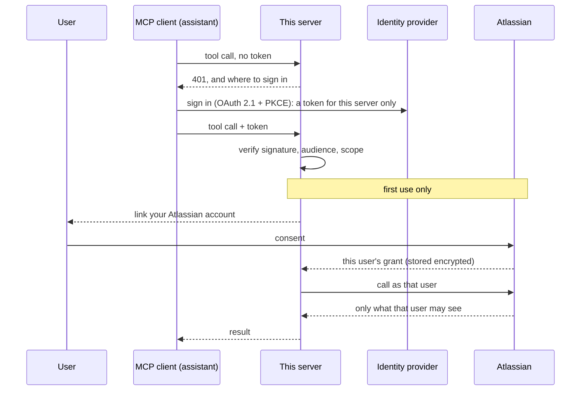

# mcp-atlassian-governed

> **Status: phase 3 of 6.** Sign-in, per-user Atlassian account linking and four read
> tools are built. Atlassian itself is a stand-in in the tests so far; nothing has been
> run against a real site yet. Write tools come next. The phases are in [PLAN.md](PLAN.md).

**An MCP server for Jira and Confluence where the agent acts as the signed-in user**, with
that user's own permissions, instead of through one shared admin token.

## The problem

An AI assistant becomes useful at work when it can reach the systems work happens in:
find the ticket, read the design page, add the comment. The quick way to give it that
reach is a service account or an admin API token in the server's configuration. Then:

- **Everyone gets the token owner's access.** A contractor's assistant can read the
  project the contractor can't.
- **Nothing ties an action to a person.** The other system's audit log shows one account
  doing everything.
- **The assistant can do whatever the token can,** including deleting things, because a
  model was told to by text it read in a ticket.
- **The token never expires,** and it sits in a config file.

This server takes the other route. Each person signs in, links their own Atlassian
account once, and every tool call runs with that person's access and nothing more.
Reading is open to them, writing has to be switched on per tool, and anything destructive
needs a confirmation the model cannot give.

## Architecture



There are two grants per user, on purpose. The MCP authorization specification forbids a
server from passing a caller's token on to another service, so the token that says *who
is calling* and the grant that says *what they may reach in Atlassian* are separate
([decision record 0001](docs/decisions/0001-a-separate-mcp-server-acting-as-the-user.md)).

## Tools

| Tool | What it does |
|------|--------------|
| `jira_search` | Issues matching a JQL query |
| `jira_get_issue` | One issue: status, people, description |
| `confluence_search` | Pages matching a CQL query |
| `confluence_get_page` | One page: title, space, text |
| `server_status` | Who you are signed in as, and whether your Atlassian account is linked |

All four Atlassian tools only read, and return only what the calling user could open
themselves. The first call from a user who hasn't linked their account returns a link to
do it.

## Quickstart

You need Docker with Compose.

```bash
git clone https://github.com/AndrewTtofi/mcp-atlassian-governed.git && cd mcp-atlassian-governed
make up
curl -s localhost:8080/healthz      # {"status":"ok","version":"0.1.0"}
```

Connect any MCP client to `http://localhost:8080/mcp` (Streamable HTTP). With the
Python SDK:

```python
import asyncio
from mcp import Client

async def main():
    async with Client("http://localhost:8080/mcp") as client:
        print([t.name for t in (await client.list_tools()).tools])   # ['server_status']
        print((await client.call_tool("server_status", {})).structured_content)

asyncio.run(main())
```

Without Docker: `python3.12 -m venv .venv && . .venv/bin/activate && make install && ALLOW_ANONYMOUS=true python -m app`.

`make up` runs the server with no identity provider, open to anyone who can reach the
port (which is bound to `127.0.0.1`).

### With sign-in

```bash
cp .env.example .env    # set the three AUTHENTIK_* values (openssl rand -hex 32 each)
make idp                # the server plus authentik on http://localhost:9000 (first boot: ~2 min)
curl -si localhost:8080/mcp -X POST | grep -i www-authenticate
# www-authenticate: Bearer error="invalid_token", …, resource_metadata="http://localhost:8080/.well-known/oauth-protected-resource/mcp"
make idp-e2e            # the whole flow in a throwaway stack, with its checks
```

### Connect Atlassian

1. Create an OAuth 2.0 (3LO) app in the [Atlassian developer console](https://developer.atlassian.com/console/myapps/)
   (**Create** → **OAuth 2.0 integration**).
2. Under **Permissions**, add the Jira API (`read:jira-work`, `read:jira-user`), the
   Confluence API (`read:confluence-content.all`, `search:confluence`) and the User
   identity API (`read:me`).
3. Under **Authorization**, set the callback URL to `http://localhost:8080/atlassian/callback`.
4. In `.env`, set `ATLASSIAN_CLIENT_ID` and `ATLASSIAN_CLIENT_SECRET` (from **Settings**),
   and `TOKEN_ENCRYPTION_KEY` (generate one with `python -m app.store`).
5. `make idp`. The first Jira or Confluence call from a user returns a link; they open
   it, sign in, consent at Atlassian, and call again.

`make idp-e2e` creates a user in the identity provider, gets a real token for them, calls
the tool with it, and then shows the tokens that must not work: one without the scope
(403), one issued for another application (401), and a tampered one (401).

## What's real vs. mocked

| Part | Status |
|------|--------|
| MCP server over Streamable HTTP | **Real.** The official SDK; tested in-process and over HTTP, and in CI against the built container |
| Host-name allow-list (DNS rebinding protection) | **Real**, tested |
| `server_status` tool | **Real**, and the only tool. It reports that Atlassian is not connected |
| Token checks | **Real.** Signature (asymmetric only), issuer, audience, expiry and scope, against a real identity provider in CI on every pull request |
| Discovery (resource metadata, 401 and 403 challenges) | **Real**, by the MCP SDK, tested |
| Identity provider | authentik in the compose stack, instead of a hosted tenant. It has no client self-registration and ignores the `resource` parameter, so the client is pre-registered and the audience is the application ([decision record 0002](docs/decisions/0002-oauth-resource-server-with-a-pre-registered-client.md)) |
| Browser sign-in (authorization code + PKCE) | **Configured, not yet exercised.** The tests get tokens the way a script does, with a user's app password |
| `make up` without an identity provider | **Open on purpose** for local use: `ALLOW_ANONYMOUS=true`, port bound to `127.0.0.1` |
| Account linking, the encrypted store, token refresh | **Real code, tested against a stand-in.** The browser flow, the identity check, encryption at rest and refresh rotation are all exercised, with Atlassian's and the identity provider's HTTP replaced by a fake built from their documentation |
| Jira and Confluence read tools | **Real code, mocked Atlassian.** Never run against a real site yet. Scopes and response shapes are the likeliest surprises |
| Write and destructive tools | **Not built yet** (phase 4) |
| Audit log | **Not built yet** (phase 5) |

## Design decisions and trade-offs

**The agent acts as the user, not as an app.** Each person's own Atlassian access is the
limit of what their assistant can do. *Trade-off:* a grant per user to store, protect and
refresh, and a second sign-in the first time.

**Two grants, never a passed-on token.** Required by the MCP specification, and right: a
token minted for one audience should not be accepted by another. *Trade-off:* more moving
parts than forwarding a header.

**A separate service, not a feature of the gateway.** MCP clients can use it directly, and
it shows the per-user model the gateway's own connectors don't have. *Trade-off:* another
thing to run.

**The browser has to prove who is sitting at it.** Before a user is sent to Atlassian to
consent, their browser signs in at the identity provider, and the result must be the user
the link was made for. Without that, an attacker could send their own link to a victim
and end up with the victim's Jira. *Trade-off:* two redirects on first use.
([0003](docs/decisions/0003-per-user-atlassian-grants.md))

**Tokens are encrypted in a SQLite file.** The file is useless without a key that lives
only in the environment, and keys can be rotated. *Trade-off:* one replica; several would
need Postgres and a shared lock for refreshes.

**One refresh at a time per user.** Atlassian's refresh tokens work once, so concurrent
refreshes would strand a caller. The new pair is saved before it is used.

**The identity provider is someone else's job.** The server verifies tokens; it doesn't
issue them, hold passwords or show consent screens. *Trade-off:* it inherits the
provider's gaps. authentik can't register clients by metadata document or bind a token to
a named resource, so the client is pre-registered and one application stands for one
audience. ([0002](docs/decisions/0002-oauth-resource-server-with-a-pre-registered-client.md))

**A refused token isn't told why.** Expired, wrong audience and bad signature are all a
401; the reason is in the server's log. *Trade-off:* harder to debug from the client side.

**No identity provider, no start.** An open server has to be asked for with
`ALLOW_ANONYMOUS=true`. *Trade-off:* one more variable for a local try-out.

**Only named hosts are served.** A local MCP server is reachable from the user's browser;
the allow-list stops a web page driving it through a DNS name it controls.
*Trade-off:* a new name or port has to be added to `ALLOWED_HOSTS`.

**The official SDK, pinned.** It carries the protocol, which is still moving (this targets
revision 2026-07-28). *Trade-off:* its major versions change the API; upgrades are
deliberate, with the lockfile hashed.

## Development

```bash
make install   # dev dependencies from the hashed lockfile
make test      # pytest
make lint      # ruff + mypy
make lock      # re-pin after editing requirements*.in
make audit     # known vulnerabilities in the lockfile
make idp-e2e   # the auth flow against a real identity provider
```

Operating it: [docs/runbook.md](docs/runbook.md).

## License

[MIT](LICENSE)
