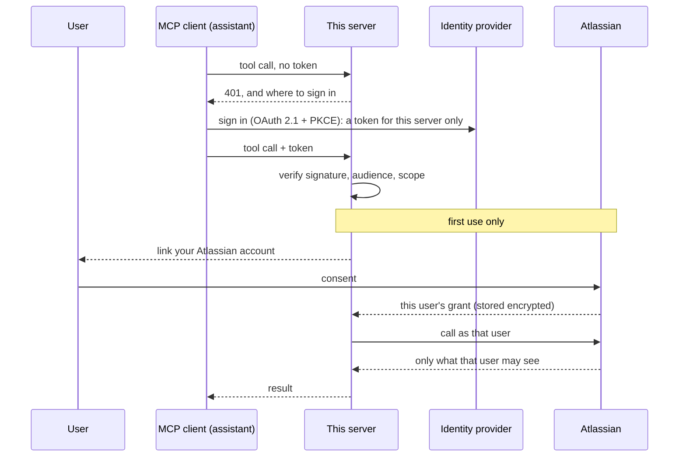

# mcp-atlassian-governed

> **Status: phase 1 of 6.** The server, its transport, tests and container are in place.
> It has one tool and nothing behind it yet. Identity comes next, then Jira and
> Confluence. The phases are in [PLAN.md](PLAN.md).

**An MCP server for Jira and Confluence where the agent acts as the signed-in user**, with
that user's own permissions, instead of through one shared admin token.

## The problem

An AI assistant becomes useful at work when it can reach the systems work happens in:
find the ticket, read the design page, add the comment. The quick way to give it that
reach is a service account or an admin API token in the server's configuration. Then:

- **Everyone gets the token owner's access.** A contractor's assistant can read the
  project the contractor can't.
- **Nothing ties an action to a person.** The other system's audit log shows one account
  doing everything.
- **The assistant can do whatever the token can,** including deleting things, because a
  model was told to by text it read in a ticket.
- **The token never expires,** and it sits in a config file.

This server takes the other route. Each person signs in, links their own Atlassian
account once, and every tool call runs with that person's access and nothing more.
Reading is open to them, writing has to be switched on per tool, and anything destructive
needs a confirmation the model cannot give.

## Architecture



There are two grants per user, on purpose. The MCP authorization specification forbids a
server from passing a caller's token on to another service, so the token that says *who
is calling* and the grant that says *what they may reach in Atlassian* are separate
([decision record 0001](docs/decisions/0001-a-separate-mcp-server-acting-as-the-user.md)).

Today only the first two boxes of the diagram exist: a client and the server.

## Quickstart

You need Docker with Compose.

```bash
git clone https://github.com/AndrewTtofi/mcp-atlassian-governed.git && cd mcp-atlassian-governed
make up
curl -s localhost:8080/healthz      # {"status":"ok","version":"0.1.0"}
```

Connect any MCP client to `http://localhost:8080/mcp` (Streamable HTTP). With the
Python SDK:

```python
import asyncio
from mcp import Client

async def main():
    async with Client("http://localhost:8080/mcp") as client:
        print([t.name for t in (await client.list_tools()).tools])   # ['server_status']
        print((await client.call_tool("server_status", {})).structured_content)

asyncio.run(main())
```

Without Docker: `python3.12 -m venv .venv && . .venv/bin/activate && make install && python -m app`.

## What's real vs. mocked

| Part | Status |
|------|--------|
| MCP server over Streamable HTTP | **Real.** The official SDK; tested in-process and over HTTP, and in CI against the built container |
| Host-name allow-list (DNS rebinding protection) | **Real**, tested |
| `server_status` tool | **Real**, and the only tool. It reports that Atlassian is not connected |
| Sign-in, token checks, scopes | **Not built yet** (phase 2). Anyone who can reach the port can call the tool, which is why the port binds to `127.0.0.1` |
| Jira and Confluence tools | **Not built yet** (phases 3 and 4) |
| Audit log | **Not built yet** (phase 5) |

## Design decisions and trade-offs

**The agent acts as the user, not as an app.** Each person's own Atlassian access is the
limit of what their assistant can do. *Trade-off:* a grant per user to store, protect and
refresh, and a second sign-in the first time.

**Two grants, never a passed-on token.** Required by the MCP specification, and right: a
token minted for one audience should not be accepted by another. *Trade-off:* more moving
parts than forwarding a header.

**A separate service, not a feature of the gateway.** MCP clients can use it directly, and
it shows the per-user model the gateway's own connectors don't have. *Trade-off:* another
thing to run.

**Only named hosts are served.** A local MCP server is reachable from the user's browser;
the allow-list stops a web page driving it through a DNS name it controls.
*Trade-off:* a new name or port has to be added to `ALLOWED_HOSTS`.

**The official SDK, pinned.** It carries the protocol, which is still moving (this targets
revision 2026-07-28). *Trade-off:* its major versions change the API; upgrades are
deliberate, with the lockfile hashed.

## Development

```bash
make install   # dev dependencies from the hashed lockfile
make test      # pytest
make lint      # ruff + mypy
make lock      # re-pin after editing requirements*.in
make audit     # known vulnerabilities in the lockfile
```

Operating it: [docs/runbook.md](docs/runbook.md).

## License

[MIT](LICENSE)
