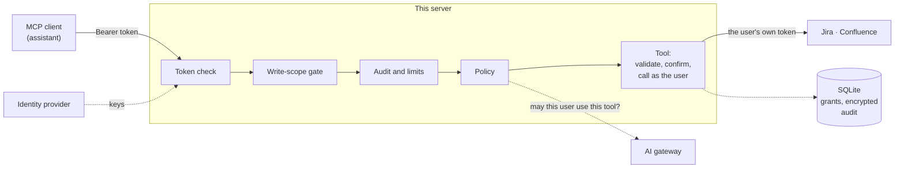

# mcp-atlassian-governed

> **Status:** all six phases are built and tested. Sign-in runs against a real identity
> provider in CI. Atlassian is a stand-in in the tests. **Run once against a real Atlassian
> site (2026-10-13): browser sign-in, account linking, a Confluence search and a Jira
> search. The write tools have not been run live.** "What's real vs. mocked" below says
> exactly which is which.

**An MCP server for Jira and Confluence where the agent acts as the signed-in user**, with
that user's own permissions, instead of through one shared admin token.

## The problem

An AI assistant becomes useful at work when it can reach the systems work happens in:
find the ticket, read the design page, add the comment. The quick way to give it that
reach is a service account or an admin API token in the server's configuration. Then:

- **Everyone gets the token owner's access.** A contractor's assistant can read the
  project the contractor can't.
- **Nothing ties an action to a person.** The other system's audit log shows one account
  doing everything.
- **The assistant can do whatever the token can,** including deleting things, because a
  model was told to by text it read in a ticket.
- **The token never expires,** and it sits in a config file.

This server takes the other route. Each person signs in, links their own Atlassian
account once, and every tool call runs with that person's access and nothing more.
Reading is open to them, writing has to be switched on per tool, and anything destructive
needs a confirmation the model cannot give.

## Architecture



There are two grants per user, on purpose. The MCP authorization specification forbids a
server from passing a caller's token on to another service, so the token that says *who
is calling* and the grant that says *what they may reach in Atlassian* are separate
([decision record 0001](docs/decisions/0001-a-separate-mcp-server-acting-as-the-user.md)).

[docs/architecture.md](docs/architecture.md) walks through each check, the two grants,
what is stored and what is trusted.

## Tools

| Tool | What it does | Kind |
|------|--------------|------|
| `server_status` | Who you are signed in as, and whether your Atlassian account is linked | read |
| `jira_search` | Issues matching a JQL query | read |
| `jira_get_issue` | One issue: status, people, description | read |
| `confluence_search` | Pages matching a CQL query | read |
| `confluence_get_page` | One page: title, space, text | read |
| `jira_add_comment` | Add a plain-text comment | write, allow-listed |
| `jira_create_issue` | Create an issue | write, allow-listed |
| `jira_delete_comment` | Delete a comment | destructive, allow-listed, confirmed by the user |
| `atlassian_unlink` | Remove your own Atlassian link from this server, to stop or to link again | account |

Three levels of control:

- **Read tools** need the `atlassian:read` scope and return only what the calling user
  could open themselves.
- **Write tools** exist only if named in `WRITE_TOOLS`, and need the `atlassian:write`
  scope. A call with a read-only token gets a 403 that names the missing scope, so the
  client can ask the user for it.
- **The destructive tool** also asks the person to confirm, through their client. The
  server reads the comment from Jira and shows them the real text and author; the model
  that requested the deletion never supplies the answer.

The first Atlassian call from a user who hasn't linked their account returns a link to
do it.

## Quickstart

You need Docker with Compose.

```bash
git clone https://github.com/AndrewTtofi/mcp-atlassian-governed.git && cd mcp-atlassian-governed
make up
curl -s localhost:8080/healthz      # {"status":"ok","version":"0.2.0"}
```

Connect any MCP client to `http://localhost:8080/mcp` (Streamable HTTP). With the
Python SDK (version 2, which `make install` below puts in a venv):

```python
import asyncio
from mcp import Client

async def main():
    async with Client("http://localhost:8080/mcp") as client:
        print([t.name for t in (await client.list_tools()).tools])   # ['server_status']
        print((await client.call_tool("server_status", {})).structured_content)

asyncio.run(main())
```

Without Docker: `python3.12 -m venv .venv && . .venv/bin/activate && make install && ALLOW_ANONYMOUS=true python -m app`.

`make up` runs the server with no identity provider, open to anyone who can reach the
port (which is bound to `127.0.0.1`). It offers `server_status` only: the Jira and
Confluence tools need to know whose access to use, so they appear once sign-in and
Atlassian are both configured (the next two sections).

### With sign-in

```bash
cp .env.example .env    # set the three AUTHENTIK_* values (openssl rand -hex 32 each)
make idp                # the server plus authentik on http://localhost:9000 (first boot: ~2 min)
curl -si localhost:8080/mcp -X POST | grep -i www-authenticate
# www-authenticate: Bearer error="invalid_token", …, resource_metadata="http://localhost:8080/.well-known/oauth-protected-resource/mcp"
make idp-e2e            # the whole flow in a throwaway stack, with its checks
```

`make idp-e2e` creates a user in the identity provider, gets a real token for them, calls
the tool with it, and then shows the tokens that must not work: one without the scope
(403), one issued for another application (401), and a tampered one (401).

### Connect Atlassian

1. Create an OAuth 2.0 (3LO) app in the [Atlassian developer console](https://developer.atlassian.com/console/myapps/)
   (**Create** → **OAuth 2.0 integration**).
2. Under **Permissions**, add the Jira API (`read:jira-work`, `read:jira-user`), the
   Confluence API (`read:confluence-content.all`, `search:confluence`) and the User
   identity API (`read:me`).
3. Under **Authorization**, set the callback URL to `http://localhost:8080/atlassian/callback`.
4. In `.env`, set `ATLASSIAN_CLIENT_ID` and `ATLASSIAN_CLIENT_SECRET` (from **Settings**),
   and `TOKEN_ENCRYPTION_KEY` (generate one with `python -m app.store`).
5. `make idp`. The first Jira or Confluence call from a user returns a link; they open
   it, sign in, consent at Atlassian, and call again.

To switch on writing, name the tools in `WRITE_TOOLS` (for example
`WRITE_TOOLS=jira_add_comment,jira_create_issue`), and add `write:jira-work` to the app's
Jira permissions and to `ATLASSIAN_SCOPES`. Users who linked before that have to link
again, because their grant doesn't carry the new scope: they call `atlassian_unlink`,
and the next call returns a link.

### Govern it with the AI gateway

With [ai-gateway](https://github.com/AndrewTtofi/ai-gateway) running, set `GATEWAY_URL`
and `GATEWAY_KEY` (a gateway key in the group its policy lets ask: `make key
name=mcp-atlassian tier=standard team=mcp-servers`, in the gateway's repo). Every tool
call is then put to the gateway's policy first and recorded in its decision log under the
user's name. If the gateway doesn't answer, the call is refused.

## What's real vs. mocked

| Part | Status |
|------|--------|
| MCP server over Streamable HTTP | **Real.** The official SDK; tested in-process and over HTTP, and in CI against the built container |
| Host-name allow-list (DNS rebinding protection) | **Real**, tested |
| `server_status` tool | **Real.** The only tool offered until sign-in and Atlassian are configured; it reports who is calling and whether their Atlassian account is linked |
| Token checks | **Real.** Signature (asymmetric only), issuer, audience, expiry and scope, against a real identity provider in CI on every pull request |
| Discovery (resource metadata, 401 and 403 challenges) | **Real**, by the MCP SDK, tested |
| Identity provider | authentik in the compose stack, instead of a hosted tenant. It has no client self-registration and ignores the `resource` parameter, so the client is pre-registered and the audience is the application ([decision record 0002](docs/decisions/0002-oauth-resource-server-with-a-pre-registered-client.md)) |
| Browser sign-in (authorization code + PKCE) | **Run once by hand** with the MCP Inspector against authentik (2026-10-13). Not automated: the tests get tokens the way a script does, with a user's app password |
| `make up` without an identity provider | **Open on purpose** for local use: `ALLOW_ANONYMOUS=true`, port bound to `127.0.0.1` |
| Account linking, the encrypted store, token refresh | **Real code, tested against a stand-in,** with Atlassian's and the identity provider's HTTP replaced by a fake built from their documentation. **Linking was also run once against a real site** and found a bug the stand-in could not: the sign-in code was redeemed under the wrong host name (fixed, with a test). A refresh was not among the things checked in that run |
| Jira and Confluence read tools | **Real code, mocked Atlassian in the tests.** `jira_search` and `confluence_search` were run once against a real site as the signed-in user. `jira_get_issue` and `confluence_get_page` were not |
| Write and destructive tools | **Real code, mocked Atlassian. Not run against a real site.** The allow-list, the scope challenge and the confirmation are exercised with the SDK's own client; the calls to Jira go to the stand-in |
| `atlassian_unlink` | **Real code, tested against the stand-in.** Written after the live run showed the need; not yet run live itself |
| The confirmation | **Real**, by the MCP SDK: the question is sent to the client, not answered by the model. A client that answers confirmations automatically would defeat it; that is the client's choice to make |
| Governed by the AI gateway's policy | **Real client, tested against a stand-in** for the gateway's `POST /v1/authorize`; the gateway's side is tested in [its own repo](https://github.com/AndrewTtofi/ai-gateway). **The two were run together once** (2026-10-13): each live call was an `allow` in the gateway's decision log under the user's name. In that run the user was added to the gateway's directory by hand, not synced from the identity provider |
| Audit record and rate limits | **Real.** A row and a log line per call, without content; per-user limits in memory |

## Design decisions and trade-offs

**The agent acts as the user, not as an app.** Each person's own Atlassian access is the
limit of what their assistant can do. *Trade-off:* a grant per user to store, protect and
refresh, and a second sign-in the first time.

**Two grants, never a passed-on token.** Required by the MCP specification, and right: a
token minted for one audience should not be accepted by another. *Trade-off:* more moving
parts than forwarding a header.

**A separate service, not a feature of the gateway.** MCP clients can use it directly, and
it shows the per-user model the gateway's own connectors don't have. *Trade-off:* another
thing to run.

**The browser has to prove who is sitting at it.** Before a user is sent to Atlassian to
consent, their browser signs in at the identity provider, and the result must be the user
the link was made for. Without that, an attacker could send their own link to a victim
and end up with the victim's Jira. *Trade-off:* two redirects on first use.
([0003](docs/decisions/0003-per-user-atlassian-grants.md))

**Tokens are encrypted in a SQLite file.** The file is useless without a key that lives
only in the environment, and keys can be rotated. *Trade-off:* one replica; several would
need Postgres and a shared lock for refreshes.

**One refresh at a time per user.** Atlassian's refresh tokens work once, so concurrent
refreshes would strand a caller. The new pair is saved before it is used.

**A user can unlink, and the policy can't stop them.** Atlassian fixes a grant to the
products and scopes present when the user consented, so a later change needs a new
consent; `atlassian_unlink` deletes the caller's own grant and the next call offers a
link. It is the one Atlassian tool the gateway is not asked about. *Trade-off:* it
deletes the server's copy only. Atlassian documents no call for an app to revoke the grant itself; the
user does that under Connected apps.
([0007](docs/decisions/0007-a-user-can-unlink-their-own-account.md))

**Writing is off until someone turns it on, tool by tool.** A write tool that isn't in
`WRITE_TOOLS` isn't offered at all, so a model can't be talked into calling it.
*Trade-off:* a config change and a restart to enable one.
([0004](docs/decisions/0004-write-tools-allow-list-scope-and-confirmation.md))

**Deleting needs a person, shown the real thing.** The server fetches the comment and
asks the user through their client. *Trade-off:* a client that can't ask can't delete,
and one extra read from Jira.

**Comments and descriptions are sent as plain text.** Whatever the model writes becomes
text nodes: it can't mention people, add links or inject markup. *Trade-off:* no
formatting.

**Every call leaves a record, and the record never holds content.** Who, which tool, what
kind, how it ended. *Trade-off:* it can show that a comment was deleted and by whom, not
what it said; that is in Jira's own history.
([0005](docs/decisions/0005-audit-record-and-rate-limits.md))

**Policy is asked of the gateway, not copied here.** With a gateway configured, every tool
call is a question to it first, and anything but a clear yes is a no, including an
outage. *Trade-off:* the gateway is on the path of every call.
([0006](docs/decisions/0006-governed-by-the-gateways-policy.md))

**The identity provider is someone else's job.** The server verifies tokens; it doesn't
issue them, hold passwords or show consent screens. *Trade-off:* it inherits the
provider's gaps. authentik can't register clients by metadata document or bind a token to
a named resource, so the client is pre-registered and one application stands for one
audience. ([0002](docs/decisions/0002-oauth-resource-server-with-a-pre-registered-client.md))

**A refused token isn't told why.** Expired, wrong audience and bad signature are all a
401; the reason is in the server's log. *Trade-off:* harder to debug from the client side.

**No identity provider, no start.** An open server has to be asked for with
`ALLOW_ANONYMOUS=true`. *Trade-off:* one more variable for a local try-out.

**Only named hosts are served.** A local MCP server is reachable from the user's browser;
the allow-list stops a web page driving it through a DNS name it controls.
*Trade-off:* a new name or port has to be added to `ALLOWED_HOSTS`.

**The official SDK, pinned.** It carries the protocol, which is still moving (this targets
revision 2026-07-28). *Trade-off:* its major versions change the API; upgrades are
deliberate, with the lockfile hashed.

## Development

```bash
make install   # dev dependencies from the hashed lockfile
make test      # pytest
make lint      # ruff + mypy
make lock      # re-pin after editing requirements*.in
make audit     # known vulnerabilities in the lockfile
make idp-e2e   # the auth flow against a real identity provider
```

Operating it: [docs/runbook.md](docs/runbook.md). What can be shown today: [docs/demo.md](docs/demo.md).

## License

[MIT](LICENSE)
