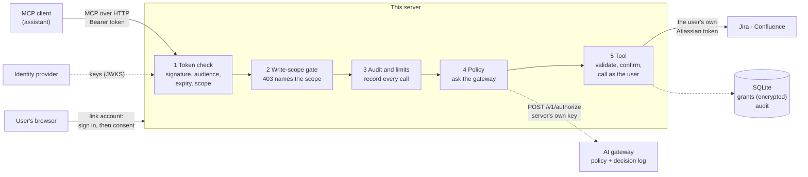
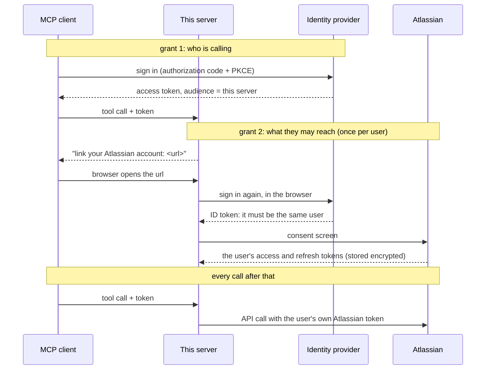

# Architecture

One small server between an AI assistant and Atlassian Cloud. Its job is to make sure
that whatever the assistant does there, it does as the person using it, with that
person's access and no more.

## The five checks on a tool call

| # | Check | Stops | Where |
|---|-------|-------|-------|
| 1 | The token was issued by the identity provider, for this server, and carries the read scope | Anyone without a valid sign-in; tokens meant for other applications | `app/tokens.py`, the SDK's middleware |
| 2 | A write tool needs the write scope, or the answer is a 403 that names it | A session the user only granted read access to | `app/scopes.py` |
| 3 | Rate limits per user; a record of the call | A runaway agent; an unanswerable "what happened?" | `app/audit.py` |
| 4 | The organisation's policy says this user may use this tool | People whose role doesn't include it; deactivated users | `app/gateway.py` |
| 5 | Arguments are validated; a deletion is confirmed by the person; the call carries the user's own Atlassian token | Path tricks; a model deleting things on someone else's say-so; reading what the user couldn't open | `app/tools.py` |

Write tools pass a sixth, earlier: they exist only if the operator named them in
`WRITE_TOOLS`.

## Two grants, never one passed along

The first token is never sent to Atlassian or to the gateway. The MCP authorization
specification forbids a server passing a caller's token on, and the reason is sound: a
token for one audience should be useless at another.

## State

| What | Where | Protected by |
|------|-------|--------------|
| Users' Atlassian tokens | `grants` table in one SQLite file | Encrypted before writing (Fernet), with a key held only in the environment; keys rotate |
| Account links in progress | `links` table | Ten-minute lifetime, single use, a separate unguessable state for each step |
| Audit records | `audit` table and the `mcp.audit` log | Hold no content; pruned after a year |
| The identity provider's keys | Memory | Refetched at most once a minute |
| Rate-limit windows | Memory | Per process |

The server is a single replica: SQLite and the in-process refresh lock both assume it.

## What it trusts

- **The identity provider,** for who someone is.
- **Atlassian,** to apply the user's permissions to each call made with their token.
- **The gateway,** for the policy decision. If it doesn't answer, the answer is no.
- **The MCP client,** to put a confirmation in front of the person. A client that answers
  confirmations by itself removes that control; the server can't tell.
- **Not the model, and not tool results.** Text from Jira and Confluence is written by
  other people. The server tells the model so in its instructions, sends only plain text
  when it writes, and never lets the model supply a confirmation.

## Decision records

[0001](decisions/0001-a-separate-mcp-server-acting-as-the-user.md) why a separate server
acting as the user ·
[0002](decisions/0002-oauth-resource-server-with-a-pre-registered-client.md) the resource
server and the identity provider's limits ·
[0003](decisions/0003-per-user-atlassian-grants.md) linking, storage and refresh ·
[0004](decisions/0004-write-tools-allow-list-scope-and-confirmation.md) write tools ·
[0005](decisions/0005-audit-record-and-rate-limits.md) audit and limits ·
[0006](decisions/0006-governed-by-the-gateways-policy.md) the gateway's policy
